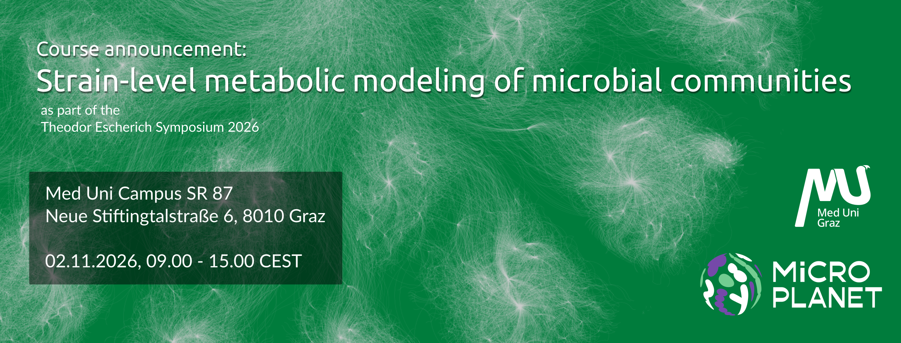

[](https://insights.medunigraz.at/en/events/detail/workshop-strain-level-metabolic-modeling-of-microbial-communities)

# Materials and Slides

This repository contains the materials and slides for the course `Strain-level metabolic modeling of microbial communities`. It generally consists of four parts

1. A course Python package that manages the installation of additional dependencies and getting data for the course.
2. Data and cached output ("treasure chest") for the course.
3. Interactive slides.
4. Google Colab Notebook that give hands-on training.

## The strainy package

This helper package should only be installed on Colab.

```bash
pip install git+https://github.com/dienerlab/2026_strain_level_course
```

This exposes several helper functions usually called `gimme_*` to download specific data sets. It also provides a `bootstrap` command that installs GAPSEQ and SEQKIT.

## Part 1: From Genome to Model & Part 2: From Model to Fluxes

Slides: [](https://dienerlab.github.io/2026_strain_course/reconstruction) &nbsp; Notebook: [](https://colab.research.google.com/github/dienerlab/2026_strain_course/blob/main/reconstruction.ipynb)

You can see the presentation with the slides link above.
Press `?` to get a list of available live options such as slide overviews and speaker mode. You can navigate the presentation using the directional buttons on your keyboard.

## Part 3: From Models to Communities

Slides: [](https://dienerlab.github.io/2026_strain_course/micom) &nbsp; Notebook: [](https://colab.research.google.com/github/dienerlab/2026_strain_course/blob/main/micom.ipynb)

You can see the presentation with the slides link above.
Press `?` to get a list of available live options such as slide overviews and speaker mode. You can navigate the presentation using the directional buttons on your keyboard.

## Emergency plan: the treasure chest

For long running scripts we provide cached results that can be downloaded within the Colab notebooks. This is exposed
through the `gimme_treasure` function in `strainy`. Just pick any file or sub-path within the [treasure_chest](/treasure_chest) folder of the respoitory.

```python
from strainy import gimme_treasure

gimme_treasure("growth.zip")

# In subfolder, will also unzip the file
gimme_treasure("gapseq/GCA_000010425.1.xml.gz", compressed=True)
```

# Licensing

[](https://opensource.org/licenses/Apache-2.0)<br>
All source code is licensed under the Apache License 2.0. This includes the notebooks deployed via Google Colaboratory.

<a rel="license" href="https://creativecommons.org/licenses/by-nc-sa/4.0/"></a><br />Content and artwork is licensed under a Creative Commons Attribution-NonCommercial-ShareAlike 4.0 International License.

This covers:

- Text content of the presentations.
- Top level images in `docs/*/assets`.

The following content is not publically available and is *not* covered under the CC license above:

- Everything in the `docs/*/assets/meduni` folders.<br>
  Those are images relating to the MedUni Graz identity like backgrounds and logos
  that are licensed exclusively to the Medical University of Graz.
- Any imaging relating to the Cluster of Excellence "Microbiomes Drive Planetary Health"<br>

If a particular creator is mentioned in the images please retain this attribution in derived materials.

# FAQ

### How do the presentation slides work?

The presentation itself is a webpage hosted on GitHub. Basically, it
renders dynamically from a [markdown file that includes the course](docs/reconstruction/talk.md).
Editing the markdown file is sufficient to change the content of the presentation.

See the [reveal docs](https://github.com/hakimel/reveal.js/#markdown) for more info.

### Preview locally

Open a terminal in the `docs` folder in the repo and use:

```bash
python -m http.server
```

This will preview the talks at `localhost:8000/reconstruction` and `localhost:8000/micom` in a browser. Editing the
markdown and reloading the page should be enough.

### PDF output

To generate a PDF of the course, open up the website in chromium or chrome and
append `?print-pdf` to the address. For instance, if you ran it locally as
described above, open `localhost:8000/micom?print-pdf` in the browser. Then, choose
'print to PDF' (choose margins: none).