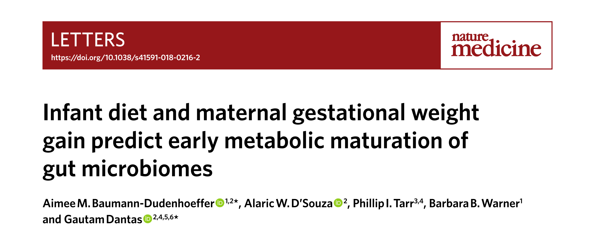
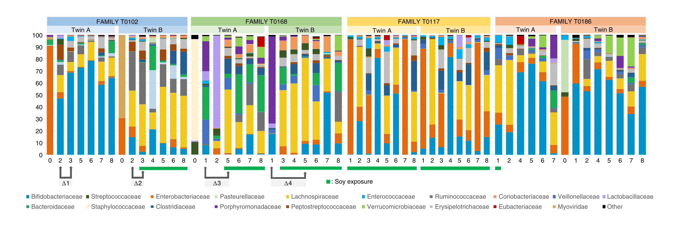
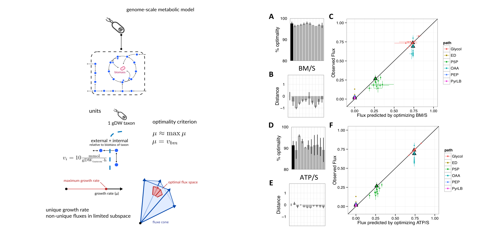
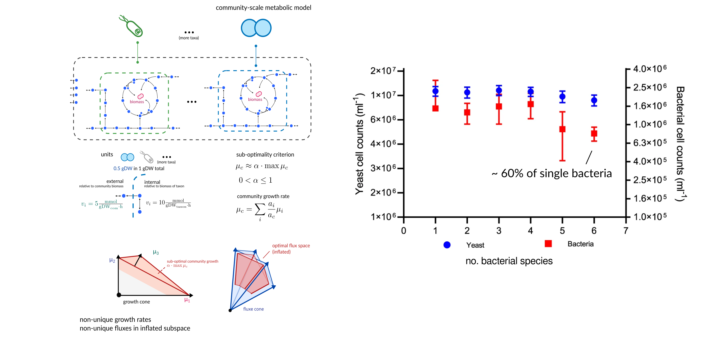
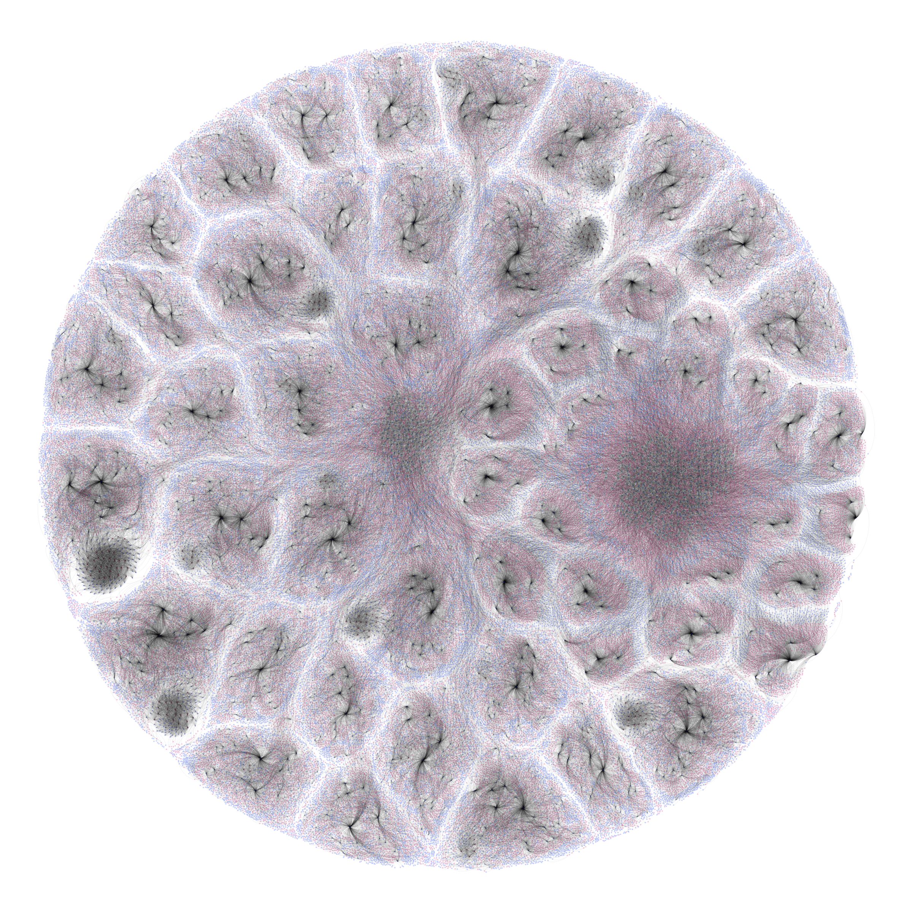
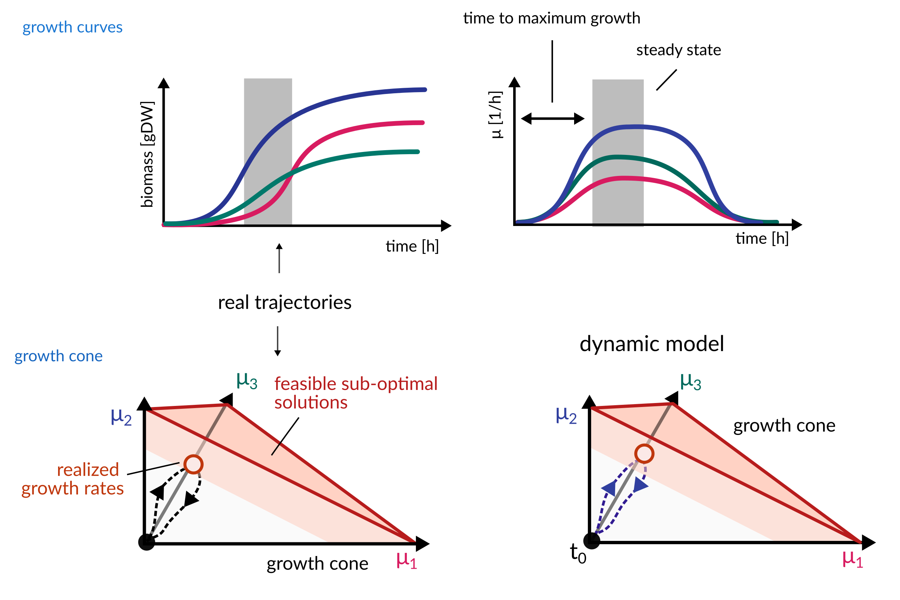
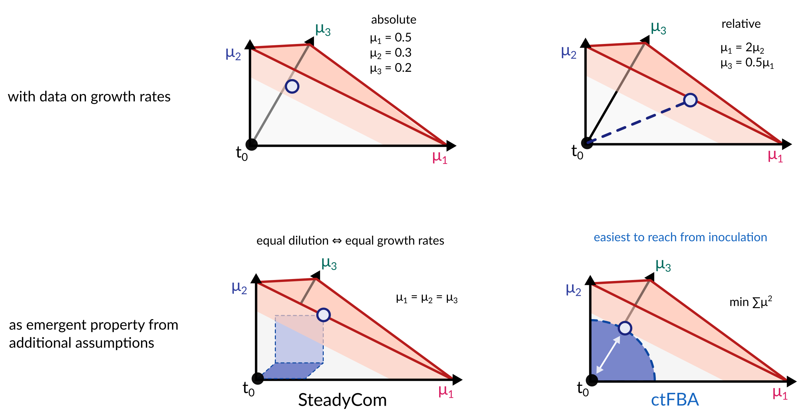
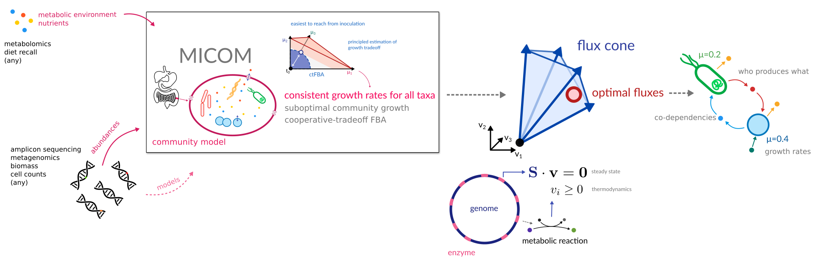
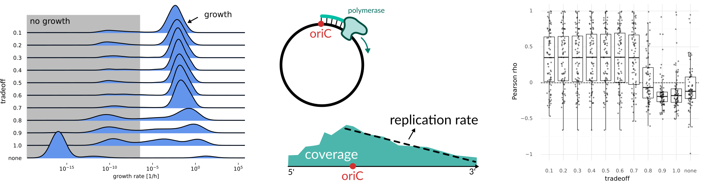
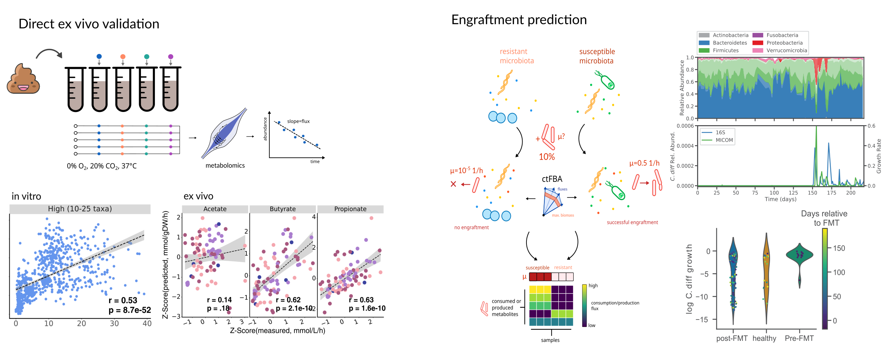

<!-- .slide: data-background="assets/backdrop.webp" class="dark" -->

## Strain-level metabolic modeling of microbial communities

# Part 3: From model to fluxes

### Christian Diener

from the *2026 Theodor Escherich Symposium*

  

<a href="https://creativecommons.org/licenses/by-sa/4.0/"><i class="fa-solid fa-camera-retro"></i>internal</a>
<a href="https://dienerlab.com"><i class="fa-solid fa-house-signal"></i></i>dienerlab.com</a>
<a href="https://github.com/dienerlab"><i class="fa-brands fa-github"></i>dienerlab</a>
<a href="https://bsky.app/profile/cdiener.com"><i class="fa-brands fa-bluesky"></i></i>@cdiener.com</a>

---

<!-- .slide: data-background="var(--primary)" class="dark" -->

Let's get the slides first (use your computer, phone, TV, fridge)

*https://dienerlab.github.io/2026_strain_course/micom*

---

## A Complex System

The intestinal metabolic environment is an *emergent property* of microbial, dietary and host interactions each consuming *and* providing specific metabolites.

Microbial metabolite production can impact the host, e.g.
- SCFA → colonoctye interactions
- bile acids → FXR/TGR5,
- pro- and anti-inflammatory compounds
- hepatic metabolism

How much of this can we glean from *genomic* data?

---

<!-- .slide: data-background="var(--primary)" class="dark" -->

## Do we know enough of the rules to play the game?

  

Explaining the behavior of microbial communities through mechanisms by using *flux balance analysis (FBA)*.

---

## Our dataset

Baumann-Dudenhoeffer AM, D’Souza AW, Tarr PI, Warner BB, Dantas G. Infant diet and maternal gestational weight gain predict early metabolic maturation of gut microbiomes. Nat Med. 2018;24: 1822–1829. https://doi.org/10.1038/s41591-018-0216-2

---

- 8 infants (4 vaginal birth, 4 cesarean)
- different age groups and diets
- 51 strains across the 8 infants (account for ~50% of abundance)

*Are there differences in metabolic functions across infants?*

---

<!-- .slide: data-background="var(--primary)" class="dark" -->

## Quick reminder :clock:

 

---

## Genome-scale metabolic models - pretty well-behaved

Schuetz et al. 2012, https://doi.org/10.1126/science.1216882 
Harcombe et al. 2013, https://doi.org/10.1371/journal.pcbi.1003091

---

## Community-scale metabolic models - pretty rowdy

Diener et al. 2023, https://doi.org/10.1128/msystems.01270-22

----

## They are also big...

Genus-level metabolic model for the gut microbiome of a single individual.

---

<!-- .slide: data-background="var(--primary)" class="dark" -->

## Let's switch to the notebook

We know how to build a community model now. Let's get started with that...

---

<!-- .slide: data-background="var(--primary)" class="dark" -->

## Uh-oh...

So there is a well-defined community growth rate $\mu_C = \sum_i \alpha_i\mu_i$ but it does not need to be at its maximum.

And even *if* we knew $\mu_C$ this does not identify unique taxon-specific growth rates $\mu_i$.

Just *great*, really :angry:

 

We need a way to identify the growth rates $\mu_i$.

---

<!-- .slide: data-background="var(--primary)" class="dark" -->

# Let's switch to the notebook

Okay, that is all just too much. Let *future me* handle this...

---

## It's all just cones

---

---

## How to pick solutions from the growth cone

---

## Properties of ctFBA

ctFBA has some properties which intuitively make sense.

1. An organism with non-zero abundance will receive a *non-zero growth rate* if the environment allows it.
2. <i>Within a single sample</i> higher growth rate *leads to higher abundance*.
3. Most common ecological interaction is *competition*.

---

That makes full community-scale metabolic models *usable*.

But even curated metabolic models for many species do not capture the full complexity of
metabolism. So are those models also *useful*?

How do we *validate* the model predictions?

---

## Is it better than the status quo?

186 metagenome samples from Swedish and Danish individuals. 
Manually curated metabolic models from the AGORA database. 
Import fluxes based on an average European diet.

Diener et al. 2020, https://doi.org/10.1128/mSystems.00606-19 
Korem, Suez, Zeevi, Weinberger et al. 2015, https://dx.doi.org/10.1126%2Fscience.aac4812 
Magnúsdóttir et al., https://doi.org/10.1038/nbt.3703

---

Quinn-Bohmann et al. 2024, https://doi.org/10.1038/s41564-024-01728-4 
Carr et al. 2025, https://doi.org/10.1016/j.cels.2025.101367 
Quinn-Bohmann et al. 2026, https://doi.org/10.1371/journal.pbio.3003638

---

## Limitations

- steady state assumption: can not *really* model abundance changes
- hard to link with (relative) concentration data (for instance metabolomics)
- limited by GSMM quality, many enzymes/metabolites not identified (bias towards CCM)
- can only model growth-associated processes (no toxicity or secondary metabolism)

---

## Your turn

Let's get our results and see what we can learn.

---

<!-- .slide: data-background="var(--primary)" class="dark" -->

# Thanks :smile:

Any open questions?

**MedUni Graz** 
Geoffrey Olweny 
Vanessa Csitkovics 
Christine Moissl-Eichinger

**Funding**  

