<!-- .slide: data-background="assets/backdrop.webp" class="dark" -->

## Strain-level metabolic modeling of microbial communities

# Part 1: From Genome to Model

### Christian Diener

from the *2026 Theodor Escherich Symposium*

  

<a href="https://creativecommons.org/licenses/by-sa/4.0/"><i class="fa-solid fa-camera-retro"></i>internal</a>
<a href="https://dienerlab.com"><i class="fa-solid fa-house-signal"></i></i>dienerlab.com</a>
<a href="https://github.com/dienerlab"><i class="fa-brands fa-github"></i>dienerlab</a>
<a href="https://bsky.app/profile/cdiener.com"><i class="fa-brands fa-bluesky"></i></i>@cdiener.com</a>

---

<!-- .slide: data-background="var(--primary)" class="dark" -->

Let's get the slides first (use your computer, phone, TV, fridge)

*https://dienerlab.github.io/2026_strain_course/reconstruction*

---

<!-- .slide: data-background="var(--primary)" class="dark" -->

## Quick reminder :clock:

 

---

# Functional analyses

Tries to predict what the microbiome *does* from sequencing data.

Uses gene/transcript/protein/metabolite abundances (metagenomics, metatranscriptomics, proteomics or metabolomics).

Gene content provides insights into metabolic *capacity* or *potential*.

---

## Sequencing

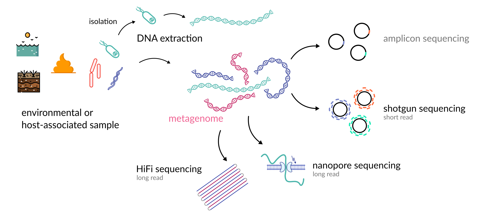

---

## Shotgun Sequencing - the "old" reliable

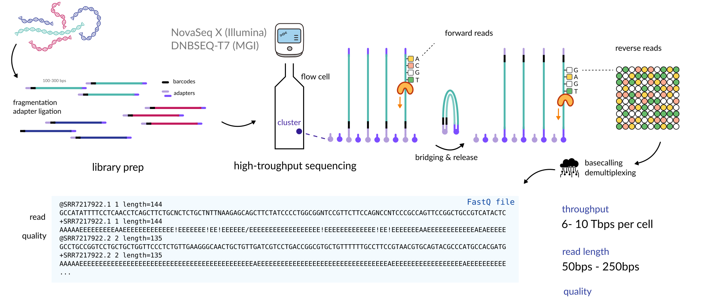

---

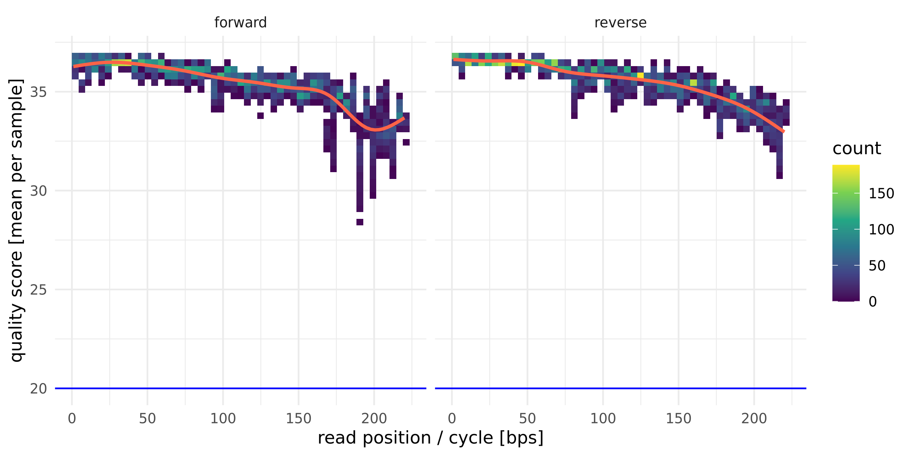

Based on some model from the sequencing machine. In ideal conditions each 10 points is an order of magnitude less
error. Those are used for filtering and trimming the reads beforehand. So a quality score of 10 is 10% error rate. 20 is
1%. 30 is 0.1%. 40 is 0.01%.
Traditionally, one aims at a quality >20 (Q20, ~1% error rate). A 1% error rate means 1-2 false bases in a 150bp read.

---

## Nanopore Sequencing - quick and long reads

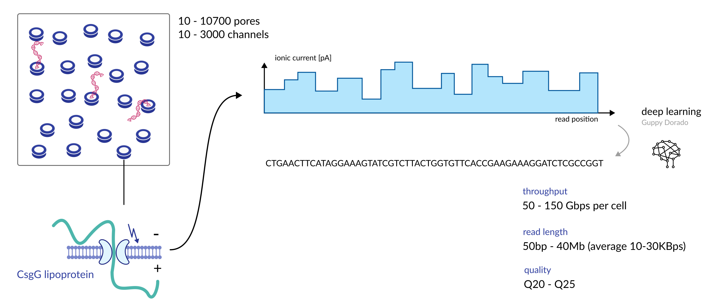

---

## HiFi sequencing - long and exact

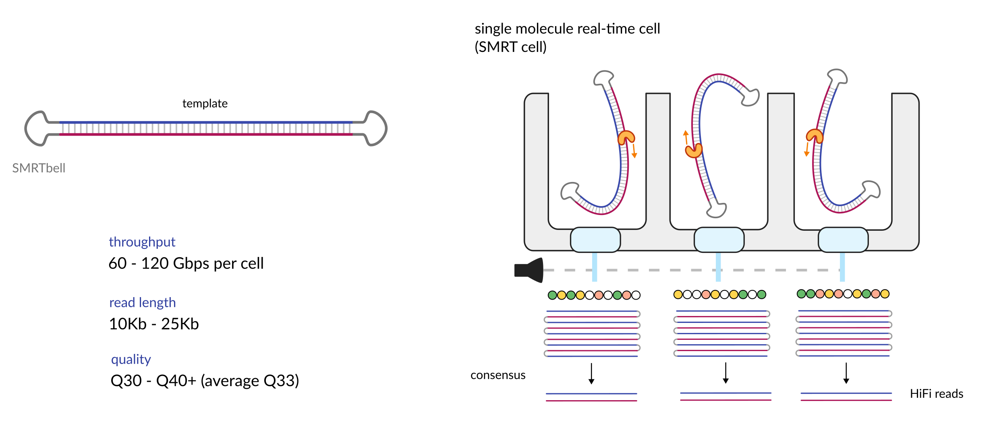

---

<!-- .slide: data-background="var(--primary)" class="dark" -->

## Let's switch to the notebook

Great we have some basics now. Let's get our own *personal isolate genome* now :sparkles:

---

<!-- .slide: data-background="var(--primary)" class="dark" -->

# How do we get from sequencing data to metabolic reactions?

Metabolic reactions are catalyzed by an organism's *enzymes*, which are encoded
in its *genes*.

So what we need is a *genome*.

So we need to *assemble* our reads into a (preferably closed) genome.

---

## Genome Assembly with De Bruijn graphs

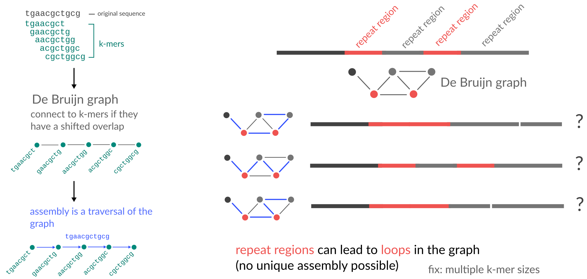

---

## Not so straight-forward

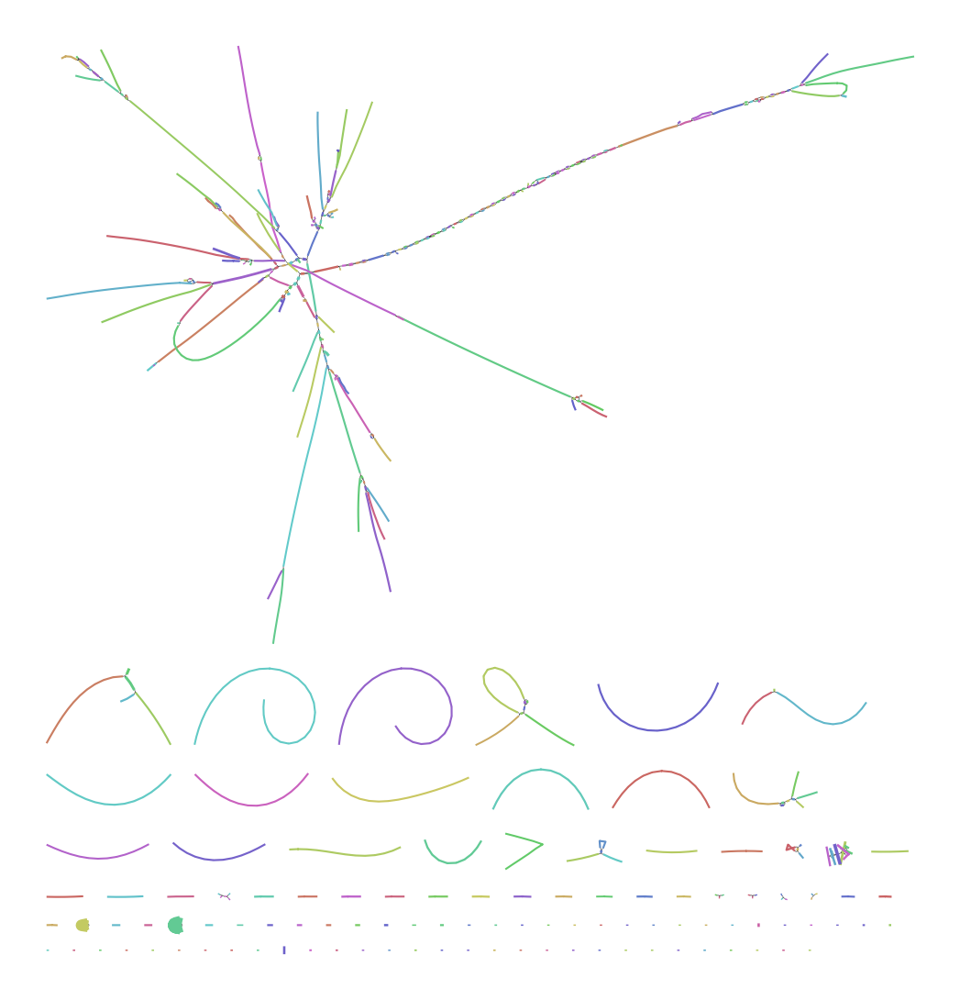

---

## Finding genes

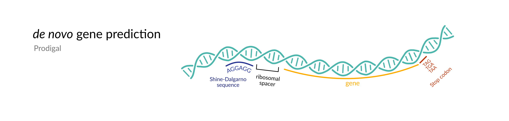

https://github.com/hyattpd/Prodigal

---

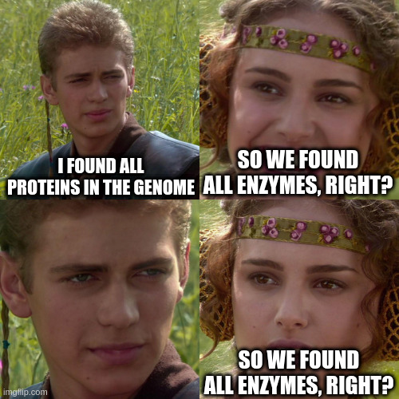

---

<!-- .slide: data-background="var(--primary)" class="dark" -->

# Genome-Scale Metabolic Model Reconstruction

The goal is to obtain the *full metabolic reaction network* from a given genome.

When mapping to reference databases, we will only ever identify a small set (~1/2) of all enzymes and transporters in a given genome.

We need to fill in the critical gaps in metabolic pathways by imposing *functional requirements* on the model.

What are reasonable requirements that *you* would attribute to a living bacterium?

---

## General strategy

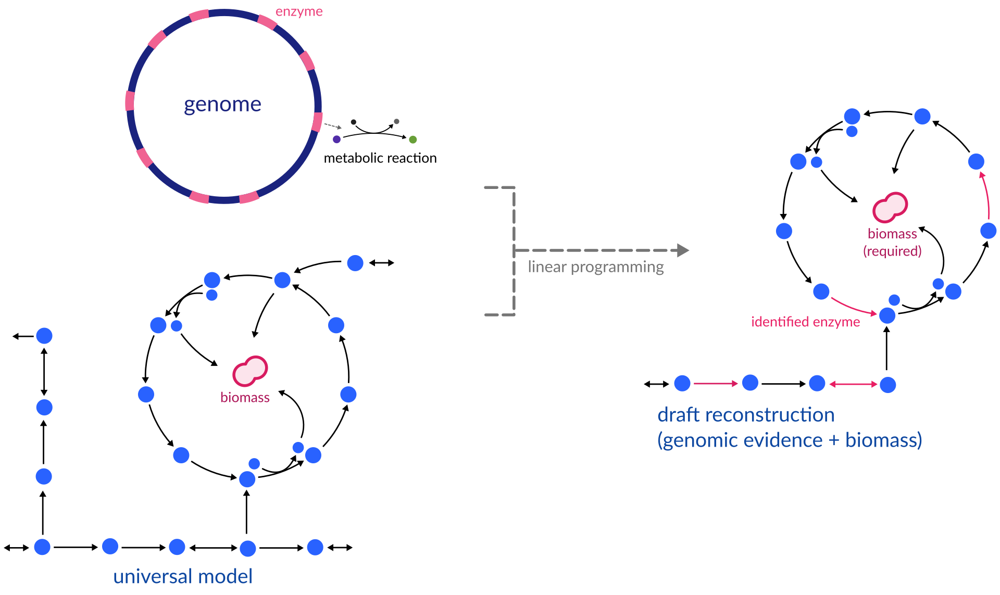

---

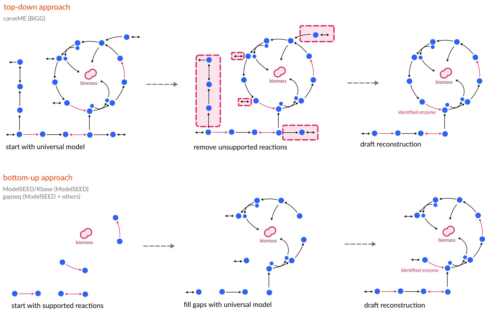

---

## GAPSEQ

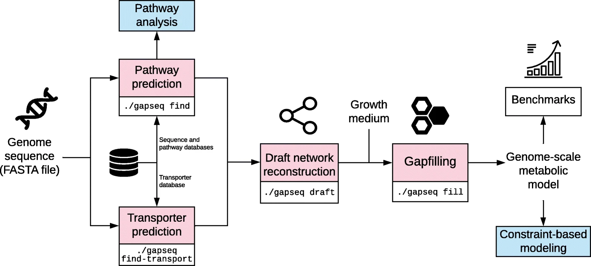

Zimmermann J, Kaleta C, Waschina S. Gapseq: Informed prediction of bacterial metabolic pathways and reconstruction of accurate metabolic models. Genome Biol. 2021;22: 81. https://doi.org/10.1186/s13059-021-02295-1

---

## GAPSEQ Pathway prediction

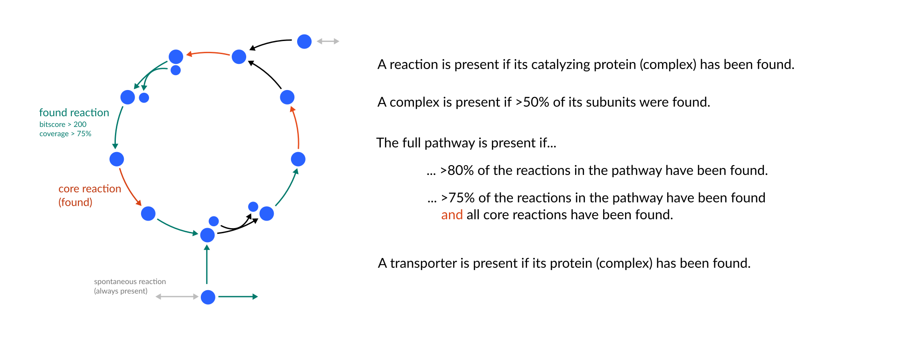

---

## Curated reconstructions

*Curation* is the process of adding or removing reactions to/from the model based on experimental evidence.

 

#### Basic

- check structural quality ([MEMOTE](https://doi.org/10.1038/s41587-020-0446-y))
- gap-filling on a standard growth medium (LB, M9, ...)
- example: [carveME EMBL GEMs](https://github.com/cdanielmachado/embl_gems) - 5587 strains

  

#### Stringent

- growth on various carbon sources (e.g. "likes maltose, but not glucose")
- known metabolic conversion (e.g. "produces indole from tryptophan")
- strain-specific biomass composition
- example: [AGORA](https://www.vmh.life/#microbes/) - 818 strains from human gut

---

|                | [carveME](https://doi.org/10.1093/nar/gky537) | [ModelSEED/Kbase](https://doi.org/10.1038/nbt.1672) | [gapseq](https://doi.org/10.1186/s13059-021-02295-1) |
|----------------|-----------|-----------------|------------|
| speed          | :smile:   | :pensive:       | :cry:      |
| sensitivity    | :pensive: | :cry:           | :smile:    |
| model quality  | :smile:   | :pensive:       | :smile:    |
| free solver    | :cry:     | :pensive:       | :smile:    |
| easy install   | :smile:   | :smile:         | :cry:      |
| easy to use    | :pensive: | :smile:         | :cry:      |
| many media     | :pensive: | :smile:         | :smile:*   |
| SBML standard  | :smile:   | :smile:         | :smile:    |

## Limitations

- unknown enzymes/pathways are never captured
- dependency on a universal model
- hard to formulate growth media
- growth objective may not always apply (e.g. toxicity, human tissues)
- biomass reactions is generally hard to curate (generic fro gram type)

---

## Your turn

Let's go from an isolate genome assembly to a genome-scale metabolic model.

---

<!-- .slide: data-background="assets/backdrop.webp" class="dark" -->

# Break time :coffee:

---

<!-- .slide: data-background="assets/backdrop.webp" class="dark" -->

## Strain-level metabolic modeling of microbial communities

# Part 2: From Model to Fluxes

### Christian Diener

from the *2026 Theodor Escherich Symposium*

  

<a href="https://creativecommons.org/licenses/by-sa/4.0/"><i class="fa-solid fa-camera-retro"></i>internal</a>
<a href="https://dienerlab.com"><i class="fa-solid fa-house-signal"></i></i>dienerlab.com</a>
<a href="https://github.com/dienerlab"><i class="fa-brands fa-github"></i>dienerlab</a>
<a href="https://bsky.app/profile/cdiener.com"><i class="fa-brands fa-bluesky"></i></i>@cdiener.com</a>

---

<!-- .slide: data-background="var(--primary)" class="dark" -->

# Genes and metabolite abundances are cool and all, but what you should really care about are metabolic fluxes*

hot take :fire:

---

## Fluxes

<video width="45%" autoplay loop>
  <source src="assets/fluxes.mp4" type="video/mp4">
</video>

video courtesy of [S. Nayyak](https://twitter.com/Na_y_ak) and [J. Iwasa](https://twitter.com/janetiwasa)

---

<!-- .slide: data-background="var(--primary)" class="dark" -->

# Flux Balance Analysis (FBA)

Can we infer the most likely fluxes in a biological system, given a set of environmental constraints, if we know all
available metabolic reactions?

---

## The flux cone

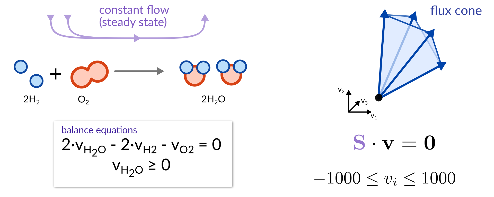

---

The goal of FBA is to *reduce* the overall flux space to a *biologically relevant* one.

---

## Genome-scale metabolic modeling

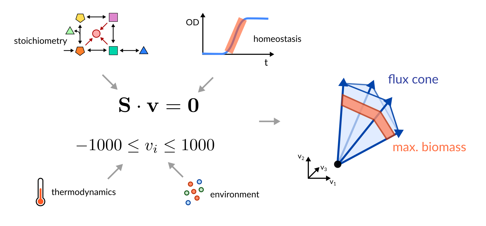

---

<!-- .slide: data-background="var(--primary)" class="dark" -->

# Optimal growth rate ≠ unique fluxes

Even though FBA yields a unique estimate of the maximum growth rate, it does not give us a unique flux solution.

Can we constrain the flux space even further?

---

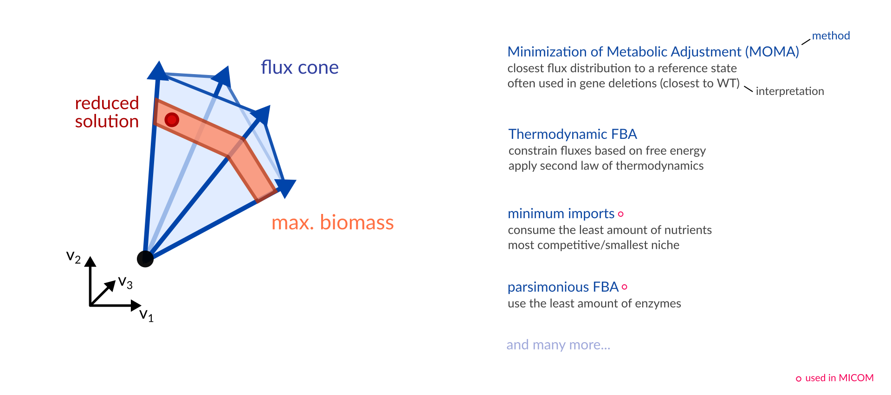

---

## Selecting biologically relevant fluxes via parsimony

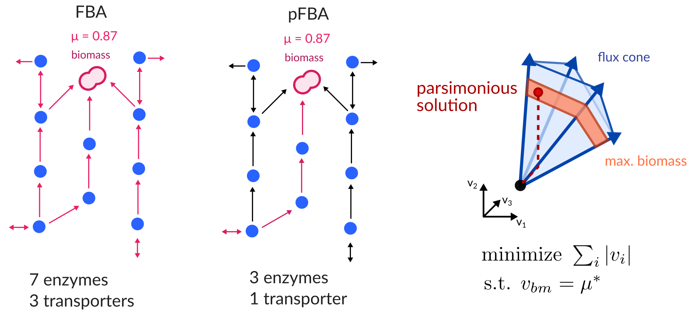

- Bacteria do not like to produce more enzymes than necessary.
- Zero flux = no enzyme required.
- Parsimony reproduces experimental fluxes in <i>E. coli</i> [very well](https://dx.doi.org/10.1038%2Fmsb.2010.47).

---

<!-- .slide: data-background="var(--primary)" class="dark" -->

FBA results strongly depend on the *environmental conditions*. Finding
uptake constraints is *critical* for realistic results.

Quantitative > qualitative >> unconstrained

Uptake and secretion fluxes are much easier to measure than internal fluxes (e.g. you can use longitudinal metabolomics).

---

## Medium reconstruction

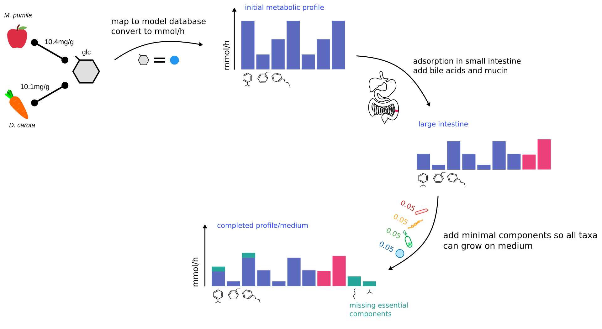

---

## Your turn

Let's estimate the fluxes for our models.

---

<!-- .slide: data-background="var(--primary)" class="dark" -->

# Thanks :smile:

We will take a lunch break and come back for part 3.

**MedUni Graz** 
Geoffrey Olweny 
Vanessa Csitkovics 
Christine Moissl-Eichinger

**Funding**  

